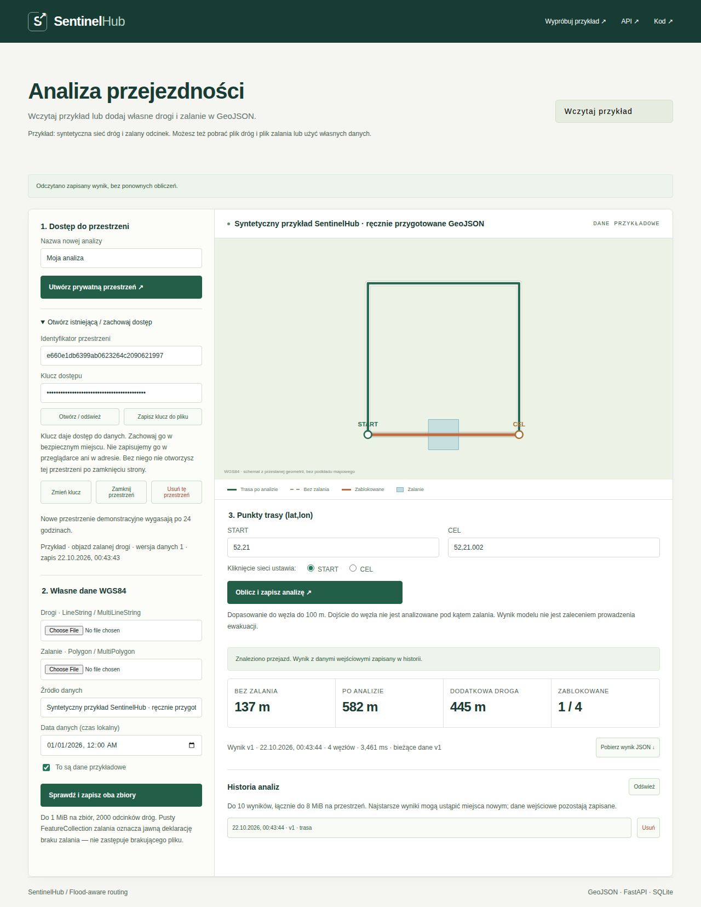

# Wdrożenie poprawek — 22.10.2026

Zakres: portfolio, TaskMesh, SentinelHub, Dual-Agent Support i System Analizy Postury.
KawiARKA i OVILE są wyłączone na polecenie użytkownika. Przywrócono stan ich plików
sprzed naszych poprawek; nie wdrożono tam zmian.

## Dostępność z niezależnej sieci

**Odbiór zakończony: wszystkie cztery demonstracje działają z publicznego internetu.**
Przebieg z opublikowanego portfolio: [39701337064](https://github.com/Adam-Sapiecha/Portfolio-AdamSapiecha/actions/runs/39701337064), 22.10.2026, około 00:44 UTC.
GitHub-hosted Ubuntu/Chromium nie korzysta z VPN, SSH, ciasteczek właściciela ani
sekretów serwera. Każda aplikacja otrzymuje nowy kontekst. Test otwiera portfolio,
rozwija kartę, klika przycisk demonstracji i wykonuje operację backendu.

| Projekt | Frontend | API/backend | Pełny test | Naprawa / ograniczenie |
| --- | --- | --- | --- | --- |
| TaskMesh | Dostępny | Dostępny | Działa | Tekst → Completed → zgodne liczniki → reload. Poprawiono konsolę, fokus i kontrast. |
| SentinelHub | Dostępny | Dostępny | Działa | Stałe `/sentinelhub/`; przykład → 582 m → historia → ponowne otwarcie kluczem. WMS niedostępny. |
| Dual-Agent Support | Dostępny | Dostępny | Działa | TECH ze źródłem → $49 → zwrot DEMO. Bez LLM, emaili i pieniędzy. |
| Analiza RGB-D | Dostępny | Dostępny | Działa | Gość → PNG/JSON → 6 cm → historia → PDF → reload; `/lab`: akceptacja i odrzucenie. |

Adresy:

- https://luxonis.tail6ad453.ts.net:8443/taskmesh/
- https://luxonis.tail6ad453.ts.net:8443/sentinelhub/
- https://luxonis.tail6ad453.ts.net:8443/support/
- https://luxonis.tail6ad453.ts.net:8443/ i `/lab`

Frontend i API każdej aplikacji mają wspólny origin. Nie dodano CORS `*` ani
wyjątków certyfikatów. Test sieci wymusza publiczne odpowiedzi DNS i waliduje TLS.
Te przepływy nie używają WebSocket/SSE; TaskMesh odświeża dane przez polling.

## Wykonane poprawki

1. Połączono aktualne `origin/main` portfolio z wcześniejszą pracą lokalną.
   Zachowano TaskMesh, nowszy Posture i treści autora. Usunięto nieaktualną zapowiedź
   NASA bez dopisywania wyniku. Uspójniono PL/EN i opis wkładu zespołowego.
2. Skrócono karty czterech demonstracji do wkładu, działania i ograniczeń.
   Architektura pozostaje w osobnych opisach. Skrócono etykiety CTA.
3. TaskMesh: usunięto sidebar, slogany, sztuczne etykiety środowiska, karty statystyk
   i panele promocyjne. Formularz jest nad historią. Zachowano workery, wynik,
   próby, zdarzenia, błędy i limity. Dodano klawiaturę zakładek, modal z pułapką
   fokusu, Escape, powrót do zadania i timeout zapytań API.
4. SentinelHub: schowano importy operatora, usunięto trzy dolne karty i uproszczono
   przykład. Rzadkie operacje dostępu są w szczegółach. Relatywne zasoby/API i base
   path działają pod prefiksem Funnel. Quick Tunnel zastąpiono stałą ścieżką.
   Ponowne otwarcie przywraca również datę danych w lokalnej strefie czasowej.
5. Support: rozmowa i dowody odpowiedzi w dwóch kolumnach, małe przyciski przykładów,
   bez schematu routera i sloganu. Zachowano źródła i narzędzia. Przewijaną rozmowę
   udostępniono klawiaturze.
6. Posture: krótszy start i przykład bez kamery. Publiczny login właściciela zwraca
   404; opcjonalny profil właścicielski ma osobny cookie i port na loopback.
   JSON ukrywa ręczną kalibrację; punkty można wprowadzać współrzędnymi klawiaturą.
   Widoczne są właściwe limity gościa i ostrzeżenia jakości.
7. Naprawiono limit sesji RGB-D: prywatny adres proxy nie łączy różnych odbiorców
   w jeden limit pięciu wejść. W takim przypadku osobne podpisane sesje mają osobne
   liczniki; globalnie nadal 30 rozpoczęć/dobę, 30 aktywnych gości i 100 MiB danych.
8. Poprawiono drobny tekst, kontrast i układy mobilne. Test kontroluje rzeczywistą
   szerokość 1280/390/360 px, brak poziomego przepełnienia i reguły axe WCAG A/AA.
   To automatyczny test wybranych stanów, nie pełna certyfikacja WCAG.
9. Repozytorium Posture jest prywatne. Publiczne odnośniki zwracające 404 zastąpiono
   informacją „Kod prywatny”; widoczność repozytorium zachowano.
10. Zapisano wersjonowane źródła odpowiadające wdrożeniu. Poprzedni publiczny compose
    SentinelHub nie opisywał działającej aplikacji. Nie kopiowano `.env`, kluczy ani
    danych roboczych do publikowanych źródeł.

## Infrastruktura i bezpieczeństwo

Dodano wyłącznie `/sentinelhub` do istniejącego publicznego Funnel 8443.
Listenerów 443 i 10000, Nextcloud, ChordLab, dashboardu, Portainera i prywatnego
TaskMesh nie zmieniano. Walidator porównał identyfikatory 12 prywatnych kontenerów
oraz konfigurację ich tras z kopią sprzed wdrożenia. Żaden nie został odtworzony.
Nie otwierano portów routera, baz, SSH ani podsieci.

Demonstracje mają osobne kontenery i magazyny, loopback na hoście, restart
`unless-stopped`, healthchecki, limity CPU/PID i rotację logów. Docker i tailscaled
są włączone przy starcie hosta. Nie restartowano całego serwera. Zachowano
poprzednie obrazy i wydania oraz spójne kopie SQLite.

Kernel Pi nie egzekwuje limitów RAM Dockera. Nie zmieniono konfiguracji rozruchu.
Support ma limity JVM; Posture i Sentinel API mają limit przestrzeni adresowej
768 MiB. Pojedynczy silnik/worker i limity wejścia ograniczają koszt operacji.
Nie jest to równoważne izolacji pamięci kontenera przez cgroup.

Publiczny nginx SentinelHub odrzuca importy operatora. Posture odrzuca też stare
ciasteczko właściciela na publicznej instancji. Zewnętrzne scenariusze sprawdzają
odmowę odczytu cudzych danych, także pomiędzy dwiema prawidłowo uwierzytelnionymi
sesjami TaskMesh, przestrzeniami SentinelHub i gośćmi Posture. Dane są syntetyczne. Publiczny Support
nie wywołuje płatnego API.

Nowe przestrzenie SentinelHub wygasają po 24 h; sprzątanie działa co 5 min i przy
utworzeniu. Migracja v1→v2 zachowuje poprzednie rekordy bez automatycznego usunięcia.
Posture ma włączony `posture-demo-cleanup.timer`: po 5 min od startu i co godzinę.
Usuwa wyłącznie wygasłych gości i ich pliki. Przetestowano to bez żądania HTTP.
Nie zerowano liczników ani nie usuwano danych innych odwiedzających.

## Odtwarzalność i ponowny odbiór

Wydania: `audit-20261022`. Commity, obrazy i sumy archiwów opisuje
`release-manifest.json`. Każdą usługę aktualizowano osobno; wolumeny i sekrety
zachowano. Kopie sprzed zmian pozostają na serwerze. Rollback SentinelHub musi
uwzględniać schemat v2 i nowe zapisy; kopię należy odtwarzać do osobnego wolumenu.

Lokalnie przeszły: SentinelHub 110 testów pytest i Ruff, Posture 38 testów unittest,
Support 19 testów Maven verify, TaskMesh TypeScript/Vite i build na Pi.
Dodatkowe CI sprawdzają PostgreSQL/procesy Rust, kontenery AMD64/ARM64 oraz restart
API SentinelHub z zachowaniem wyniku. Linki do zakończonych przebiegów poniżej.

Ponowny test: GitHub Actions → `Public demo flows` → `Run workflow` na main.
Alternatywnie: `npm ci`, instalacja Chromium Playwright, `npm run test:links`,
`npm run test:public` na komputerze poza siecią domową. Skrypt zapisuje JSON
i zrzuty w `test-results`. Sam lokalny przebieg nie dowodzi niezależnej sieci.

Nie wykonywano testu po 24 h bezczynności, zaniku zasilania ani odnowienia TLS.
Do takiego odbioru: LTE/5G bez Wi-Fi/VPN → publiczne portfolio → każda operacja;
osobno kontrolowany restart hosta w oknie utrzymaniowym. Port 8443 może być blokowany
przez niektóre sieci firmowe; runner nie obejmuje każdej polityki sieciowej.
Import Sentinel WMS wymaga odnowienia konta i pozostaje jawnie niedostępny.
Nie odnawiano płatnego konta ani nie deklarowano walidacji klinicznej/ewakuacyjnej.

## Końcowe dowody

- [Pełny test publicznego portfolio i demonstracji — sukces](https://github.com/Adam-Sapiecha/Portfolio-AdamSapiecha/actions/runs/39701337064)
- [Publikacja GitHub Pages — sukces](https://github.com/Adam-Sapiecha/Portfolio-AdamSapiecha/actions/runs/39701337016)
- [SentinelHub: 110 testów, Ruff, przeglądarka, restart API i obrazy AMD64/ARM64 — sukces](https://github.com/Adam-Sapiecha/SentinelHub/actions/runs/39701078869)
- [Support: weryfikacja Java — sukces](https://github.com/Adam-Sapiecha/Dual-agent-support-chatbot/actions/runs/39699575732)
- Posture: 38 testów i kontenery AMD64/ARM64 — sukces w prywatnym repozytorium, przebieg 39699583982.
- [TaskMesh: TypeScript/Vite, fmt/Clippy, PostgreSQL/procesy i natywne obrazy AMD64/ARM64 — sukces](https://github.com/Adam-Sapiecha/TaskMesh/actions/runs/39700554339)

Trwałe dowody w repozytorium:
[scenariusze i odpowiedzi backendów](evidence/2026-10-22/external-flows.json),
[publiczny DNS, TLS, HTTP i preflight](evidence/2026-10-22/network-audit-external.json),
[manifest wydania](release-manifest.json).
15 odczytów HTTP zwróciło 200 z poprawnie zweryfikowanym TLS.
W pięciu scenariuszach (cztery aplikacje i dodatkowy przykład RGB-D) nie wystąpiły
błędy JavaScript. Kontrole axe przeszły w 1280/390/360 px, także dla portfolio.
Zapisane wyniki: tekst 22 znaki / 2 linie / 4 słowa; objazd 582 m;
TECH/BILLING i zwrot DEMO; syntetyczne RGB-D 6 cm, historia i prawidłowy PDF.

Lokalny katalog portfolio również zaktualizowano do opublikowanego main.
Dodatkowa kopia wcześniejszego WIP: stash `98b29e9c2c386b1a2eb103ab2fb37b502ecd4267`.
Pliki `docs/content-audit.md` i `docs/demo-preparation-prompt.md` odtworzono lokalnie;
starszych wersji zaktualizowanych plików nie nakładano na nowe źródła.
Szczegóły synchronizacji: lokalne `output/implementation-2026-10-21/local-main-sync.json`.
